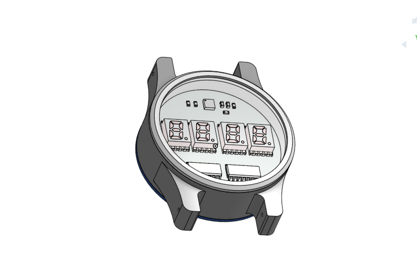
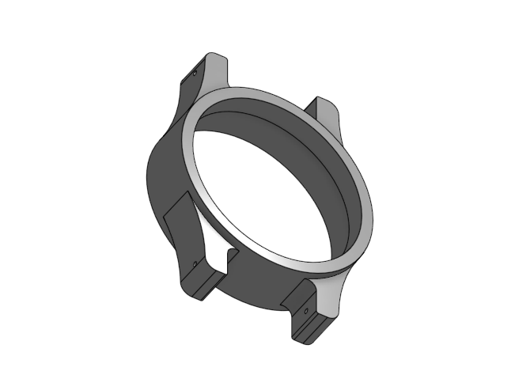
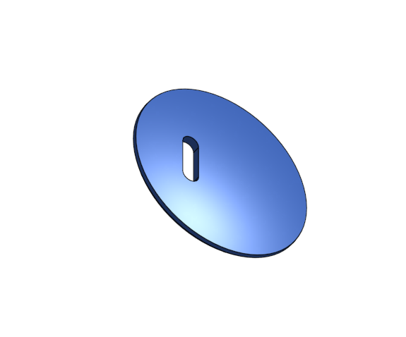
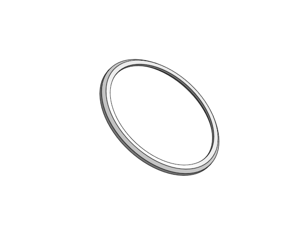
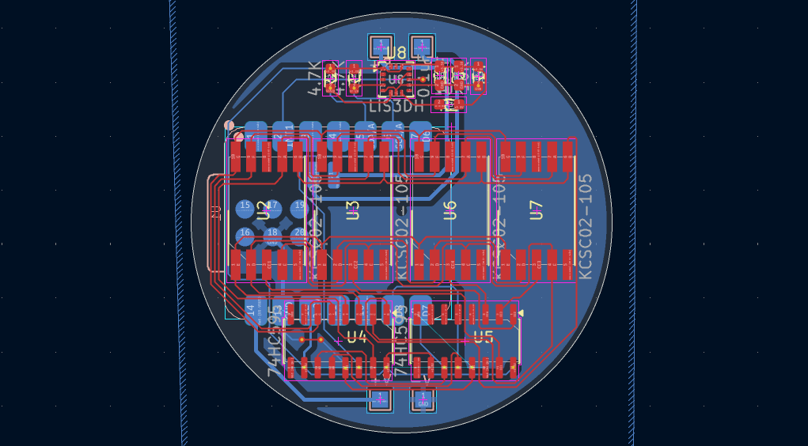
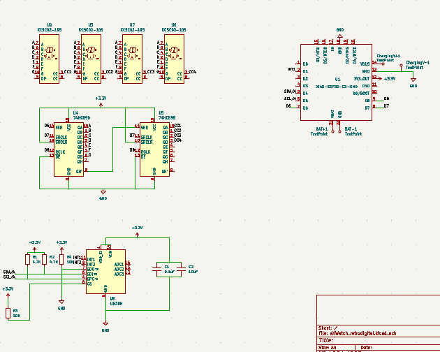

# RetroDigitalWristWatchO1
A Retro Futuristic wrist watch inspired from nixie tube wrist watch.

# CAD 

## total assembly

This is the look im aiming for !

## case

this is the middle section or the main body of the watch 

This is the bottom plate. the bottom plate has magnetic connector for charging

This is the top plate and its suppose to hold a 1 mm thick 40mm watch crystal.

# PCB 

THE PCB ! (took a few tries to get a decent routing for 2 layer pcb)

And the schematic 

# Assembly
The case is really precise and there in very little room for fancy connection system to put the case together im thinking to superrglue the top and glass to the body. there is going to be a grove to aling them. and same goes for the bottom but without the glue.

# Firmware
Currently the firmware includes a really basic code to test the displays i need to get the components to update the code to work it properly with all the functions

# BOM

| # | Component | Quantity |
|---:|---|---:|
| 1 | Seeed Studio XIAO ESP32-C3 | 1 |
| 2 | 0.2-inch single-digit SMD 7-segment display, common-cathode | 4 |
| 3 | 74HC595 shift register | 2 |
| 4 | LIS3DH 3-axis accelerometer | 1 |
| 5 | 1S LiPo battery | 1 |
| 6 | 4.7 kΩ resistor | 2 |
| 7 | 100 nF ceramic capacitor | 3 |
| 8 | 10 µF ceramic capacitor | 1 |
| 9 | magnetic connector 2 pin | 1 set |
| 10 | Custom 2-layer PCB | 1 |
| 11 | Watch case | 1 |
| 12 | Watch crystal/lens | 1 |
| 13 | 20 mm watch strap | 1 |
| 14 | Spring bars | 2 |

# Conclusion 
It was one of the hardest project for me because i had to learn Onshape and CAD from groundup. and the pcb routing took a few tries to make it work in 2 layer. But it was done with the help of gpt on helping me to choose right symbol in kicad and helping me navigate cad software.

